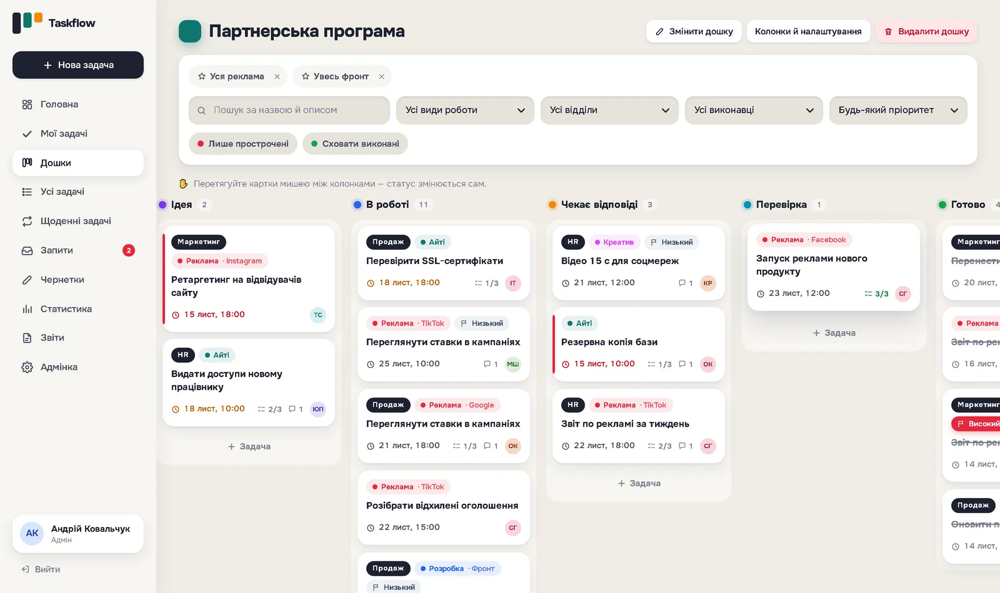
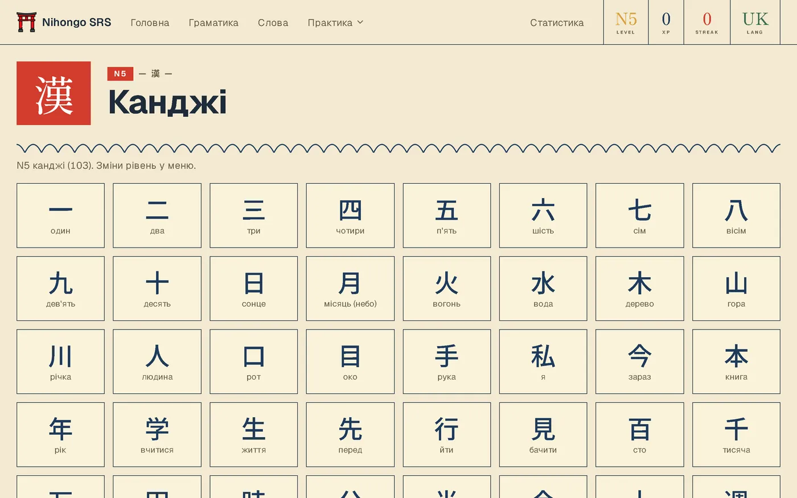

### Привіт! Пишу веб-застосунки на Next.js і TypeScript

Full-stack: інтерфейс на React, сервер на Server Actions, дані через Prisma в PostgreSQL або SQLite. До вебу були C++, Qt і Unreal Engine.

**Портфоліо зі скриншотами:** [mariia157.github.io](https://mariia157.github.io)

---

#### [Taskflow](https://github.com/Mariia157/task-manager)

Трекер задач для команди з кількох відділів. Дошки як у Trello, а також чотири рівні доступу, запити на погодження, підзадачі, щоденні задачі, звіти в PDF і Telegram-бот зі сповіщеннями.

`Next.js 16` `TypeScript` `Prisma` `SQLite` `dnd-kit` `PDFKit` `Telegram Bot API` `Vitest`

#### [Nihongo SRS](https://github.com/Mariia157/japanese-study-web)

Тренажер японської для рівнів JLPT N5–N1. Слова, кандзі й граматика проходять через один алгоритм інтервальних повторень SM-2. Курс граматики за уроками Genki, фуригана над кандзі, аудіювання через Web Speech API, інтерфейс англійською та українською.

`Next.js 16` `TypeScript` `Tailwind v4` `Prisma 7` `SQLite / PostgreSQL` `Recharts` `Vitest`

#### [RagePC](https://github.com/Mariia157/RagePC)

Інтернет-магазин комплектуючих і готових збірок. Конфігуратор перевіряє сумісність сокета, пам'яті, форм-фактора й габаритів і рахує споживання збірки. Є каталог із фільтрами, кошик, замовлення й особистий кабінет, три мови та темна тема.

`Next.js 16` `React 19` `TypeScript` `Prisma` `PostgreSQL` `Tailwind CSS`

---

#### Раніше

| Проєкт | Що це | Стек |
|---|---|---|
| [TimeRun](https://github.com/Mariia157/TimeRun) | Прототип гри з режимами платформера, бою та сайд-скролера | C++, Unreal Engine 5 |
| [DoodleJump](https://github.com/Mariia157/DoodleJump) | Аркадний платформер-стрибалка з ворогами й чорними дірами | C++, SDL |
| [QtCalculator](https://github.com/Mariia157/QtCalculator) | Десктопний калькулятор | C++, Qt Widgets |
