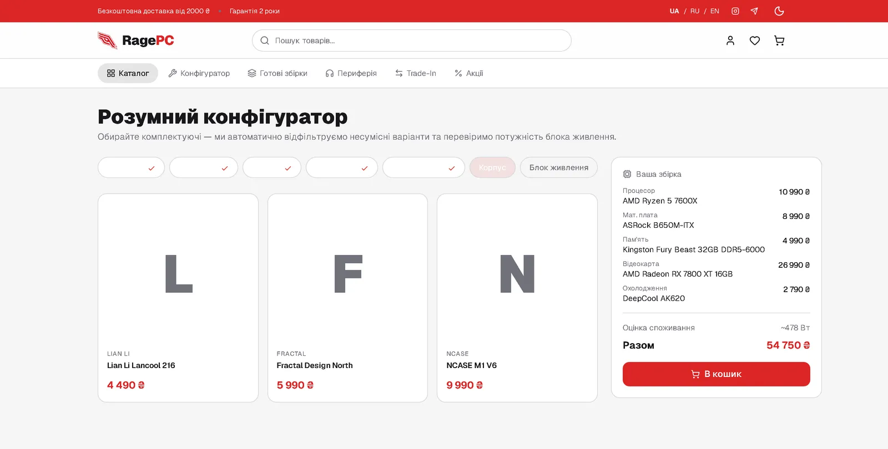

### Hi! I build web apps with Next.js and TypeScript

Full-stack: React on the front end, Server Actions on the server, data through Prisma in PostgreSQL or SQLite. Before the web, I worked with C++, Qt and Unreal Engine.

**Portfolio with screenshots:** [mariia157.github.io](https://mariia157.github.io)

---

#### [Taskflow](https://github.com/Mariia157/task-manager)

A task tracker for a team with several departments. Trello-style boards plus four access levels, approval requests, subtasks, daily tasks, PDF reports and a Telegram bot with notifications.

`Next.js 16` `TypeScript` `Prisma` `SQLite` `dnd-kit` `PDFKit` `Telegram Bot API` `Vitest`

#### [Nihongo SRS](https://github.com/Mariia157/japanese-study-web)

A Japanese trainer for JLPT levels N5 to N1. Vocabulary, kanji and grammar all go through one SM-2 spaced repetition algorithm. A grammar course built on the Genki lessons, furigana above kanji, listening via the Web Speech API, and an interface in English and Ukrainian.

`Next.js 16` `TypeScript` `Tailwind v4` `Prisma 7` `SQLite / PostgreSQL` `Recharts` `Vitest`

#### [RagePC](https://github.com/Mariia157/RagePC)

An online store for PC components and prebuilt systems. The configurator checks socket, memory, form factor and size compatibility and estimates the build's power draw. Also a filtered catalog, cart, orders and an account page, three languages and a dark theme.

`Next.js 16` `React 19` `TypeScript` `Prisma` `PostgreSQL` `Tailwind CSS`

---

#### Earlier

| Project | What it is | Stack |
|---|---|---|
| [TimeRun](https://github.com/Mariia157/TimeRun) | A game prototype with platforming, combat and side-scrolling modes | C++, Unreal Engine 5 |
| [DoodleJump](https://github.com/Mariia157/DoodleJump) | An arcade jumping platformer with enemies and black holes | C++, SDL |
| [QtCalculator](https://github.com/Mariia157/QtCalculator) | A desktop calculator | C++, Qt Widgets |
